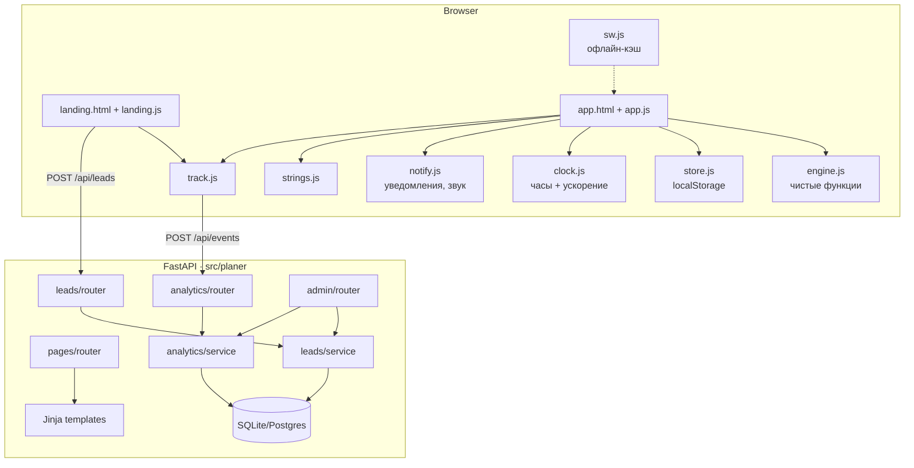

# Архитектура «Вовремя»

Единый источник правды по устройству проекта. Требования — в `specs/spec.md`.

## 1. Компоненты



### Бэкенд
- `create_app(settings)` — фабрика без глобального состояния: engine и
  sessionmaker кладутся в `app.state`, зависимость `get_session` берёт их оттуда.
  Тесты поднимают приложение на временной SQLite (`create_schema=True`).
- `planer` (CLI) = `alembic upgrade head` + `uvicorn` (factory).
- Слои: `router → service (DAO) → models`. Схемы ввода/вывода — pydantic.
- Конфигурация — `pydantic-settings`, префикс `PLANER_`, файл `.env`.

### Фронтенд
- Без сборки: ES-модули грузятся напрямую, версия в `?v=` для сброса кэша.
- `engine.js` не знает о DOM и текущем времени — всё получает аргументами.
- `app.js` — единственный модуль, который трогает DOM; рендер по hash-маршруту,
  тик раз в секунду только перерисовывает строку состояния и таймер.
- `sw.js` — network-first с офлайн-фолбэком (обновления видны сразу, без сети
  работает из кэша).

## 2. Поток запуска плана

```mermaid
sequenceDiagram
  participant U as Пользователь
  participant A as app.js
  participant E as engine.js
  participant S as store.js
  U->>A: «Начать»
  A->>E: startRun(plan, now, clock)
  E-->>A: run (startKind early/ontime/late, allotted[0])
  A->>S: saveRun(run)
  A-->>U: сообщение + таймер
  loop каждую секунду
    A->>E: runStatus(run, now)
    E-->>A: remaining, scheduleDelta, projectedFinish, overdue
    A-->>U: строка состояния, title
    alt overdue и не уведомлён
      A-->>U: уведомление + звук; run.items[i].notified = true
    end
  end
  U->>A: «Закончить»
  A->>E: finishItem(run, now) → startItem(next, now)
  E-->>A: allotted следующего (сжатие при опоздании)
  A->>S: saveRun(run)
  Note over A,E: после последнего пункта — summarize(run, plan)
```

## 3. Модель времени
- Все расчёты — в мс «виртуального» времени `clock.now()`.
- `clock = { speed, realBase, virtualBase }`; `now = virtualBase + (Date.now() − realBase) × speed`.
  Обычный режим: `speed = 1`. Демо: ×10 или ×60.
- Финиш плана фиксируется при старте запуска и не меняется. Пересчёт идёт
  только при старте пункта (FR-9), поэтому выделенное время пункта стабильно,
  пока он идёт.
- Алгоритм сжатия — `specs/001-engine/spec.md` §3.3.

## 4. Хранение

| Где | Что | Ключ/таблица |
|---|---|---|
| localStorage | планы | `planer.v1.plans` |
| localStorage | активный запуск | `planer.v1.run` |
| localStorage | последние итоги (20) | `planer.v1.runs` |
| localStorage | настройки (скорость, звук) | `planer.v1.settings` |
| localStorage | анонимный ID сессии | `planer.v1.sid` |
| БД | заявки | `leads` (email уникален) |
| БД | события | `events` (name, session_id, props JSON) |

## 5. События аналитики

| Событие | Где | props |
|---|---|---|
| `landing_view` | лендинг, загрузка | `s` (сегмент из `?s=`), `ref` |
| `cta_click` | лендинг, CTA | `place` |
| `pricing_click` | лендинг, тариф | `tier` |
| `lead_form_open` | лендинг, форма в фокусе | `tier` |
| `app_open` | приложение, загрузка | `speed` |
| `plan_created` | приложение | `source` (blank/template id) |
| `run_started` | приложение | `kind` (early/ontime/late), `items`, `speed` |
| `run_finished` | приложение | `status`, `delta_min`, `items` |
| `suggestion_accepted` | итоги | `type` (shorten/extend/split) |

Без cookies и сторонних счётчиков; `session_id` — случайная строка в localStorage.

## 6. Ограничения браузера (важно для презентации)
- Chrome замедляет таймеры скрытых вкладок (до 1 раза в минуту через 5 мин) —
  время не «плывёт», но уведомление может прийти с задержкой до минуты.
- iOS Safari показывает уведомления только у PWA, добавленного на экран «Домой»
  (iOS 16.4+), и не будит закрытую вкладку.
- Уведомления требуют HTTPS (кроме `localhost`).
