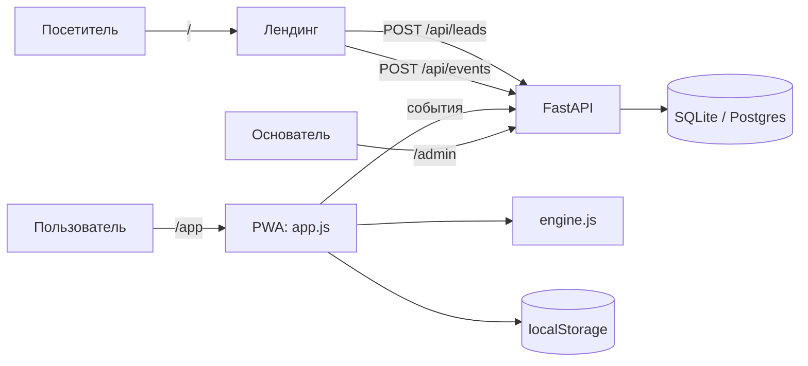

# Спецификация: «Вовремя» (planer)

**Статус:** Active
**Версия:** 0.1.1-alpha
**Автор:** Kirill Borovoy
**Создано:** 2026-10-28
**Обновлено:** 2026-10-28

---

## 1. Обзор

### 1.1 Назначение
Планер, который ведёт по плану в реальном времени. У плана есть время начала
(или «закончить к»), у пунктов — ориентировочная длительность. Приложение
отсчитывает время пункта, предупреждает о превышении и при опоздании
пересчитывает оставшиеся пункты, чтобы закончить вовремя. После выполнения
предлагает поправить оценки по фактическому времени.

### 1.2 Цель MVP
MVP нужен для **проверки спроса**, а не для продаж: показать на презентации,
дать попробовать в браузере, собрать заявки и метрики воронки (см. анализ
ниш: личные рутины и СДВГ, тайминг мероприятий и встреч).

### 1.3 Границы (Scope)
- **Входит:** лендинг с тарифами-«фейковой дверью» и формой заявки; веб-приложение
  (PWA) с планами, запуском, пересчётом, уведомлениями и итогами; админка с
  воронкой; демо-ускорение времени для презентаций.
- **Не входит:** аккаунты и синхронизация между устройствами; оплата;
  нативные приложения; совместная работа и вывод таймера на экран сцены;
  календари; надёжные уведомления в фоне на iOS (ограничение браузера).

### 1.4 Акторы
| Актор | Роль | Контекст |
|---|---|---|
| Пользователь | ведёт свой план | утро, сборы, рабочий день, программа мероприятия |
| Посетитель лендинга | оценивает идею | приходит из рекламы/чатов, оставляет заявку |
| Основатель (admin) | проверяет спрос | смотрит воронку, выгружает заявки |
| Презентующий | показывает MVP | демо-режим ×60 |

---

## 2. Требования

### 2.1 Функциональные (FR)
| ID | Требование | Приоритет |
|---|---|---|
| FR-1 | Создать план: название, время начала **или** «закончить к», пункты с длительностью в минутах | Must |
| FR-2 | Пункт можно отметить «фиксированный» — он не сжимается | Must |
| FR-3 | Видно расписание: время начала каждого пункта и финиш плана | Must |
| FR-4 | Запуск плана или с любого пункта; классификация: раньше / вовремя (±1 мин) / позже | Must |
| FR-5 | Раньше: «Отлично, идём с запасом», пункты по заданному времени, финиш раньше | Must |
| FR-6 | Вовремя: отсчёт заданного времени пункта | Must |
| FR-7 | Позже: «Кажется, мы опаздываем, придётся поторопиться», пропорциональное сжатие оставшихся несфиксированных пунктов, чтобы закончить вовремя | Must |
| FR-8 | Сжатие не глубже лимита плана (по умолчанию 50%); если не хватает — прогноз опоздания и предложение пропустить пункт | Must |
| FR-9 | Кнопка «Закончить» у пункта; время следующего пункта пересчитывается при его старте | Must |
| FR-10 | По окончании времени пункта — уведомление (системное + звук + вибрация), затем отсчёт превышения в пункте и строке состояния | Must |
| FR-11 | Строка состояния: текущий пункт, остаток/превышение, опережение/опоздание по графику, прогноз финиша; дублируется в заголовке вкладки | Must |
| FR-12 | Итоги: план/выделено/факт по каждому пункту | Must |
| FR-13 | Факт меньше плана более чем на 10% → предложить сохранить сокращённое значение или отказаться | Must |
| FR-14 | Факт больше плана более чем на 10% → предложить увеличить время или разбить на подпункты | Must |
| FR-15 | Подсказки опираются на медиану последних запусков (от 3), а не на один прогон | Should |
| FR-16 | Шаблоны планов (утро, мероприятие, встреча, демо) | Should |
| FR-17 | Демо-ускорение времени ×10 / ×60 | Must (презентация) |
| FR-18 | Состояние запуска переживает перезагрузку страницы | Must |
| FR-19 | Лендинг: проблема, как работает, тарифы, форма заявки с сегментом | Must |
| FR-20 | Анонимная аналитика воронки и админка `/admin` с конверсиями и выгрузкой CSV | Must |
| FR-21 | Пауза плана | Could |

### 2.2 Нефункциональные (NFR)
| ID | Требование | Как проверяется |
|---|---|---|
| NFR-1 | Приложение работает без сервера после первой загрузки (PWA, localStorage) | Отключить сеть, перезагрузить `/app` |
| NFR-2 | Таймер точен по часам, а не по тикам: троттлинг вкладки не копит ошибку | Тест движка: время берётся из `now` |
| NFR-3 | Мобильная вёрстка от 360 px, светлая и тёмная тема | Просмотр на 375 px |
| NFR-4 | Движок покрыт тестами; каждый эндпоинт — тестом | `node --test`, `pytest` |
| NFR-5 | Персональные данные: email только в БД, в логах — домен | Ревью логов |
| NFR-6 | Запуск одной командой: `uv run planer` | README |

---

## 3. Архитектура

См. [docs/architecture.md](../docs/architecture.md).

## 4. Метрики проверки спроса
Критерии «продолжать / остановиться» — в `specs/plan.md`, раздел «Валидация».
